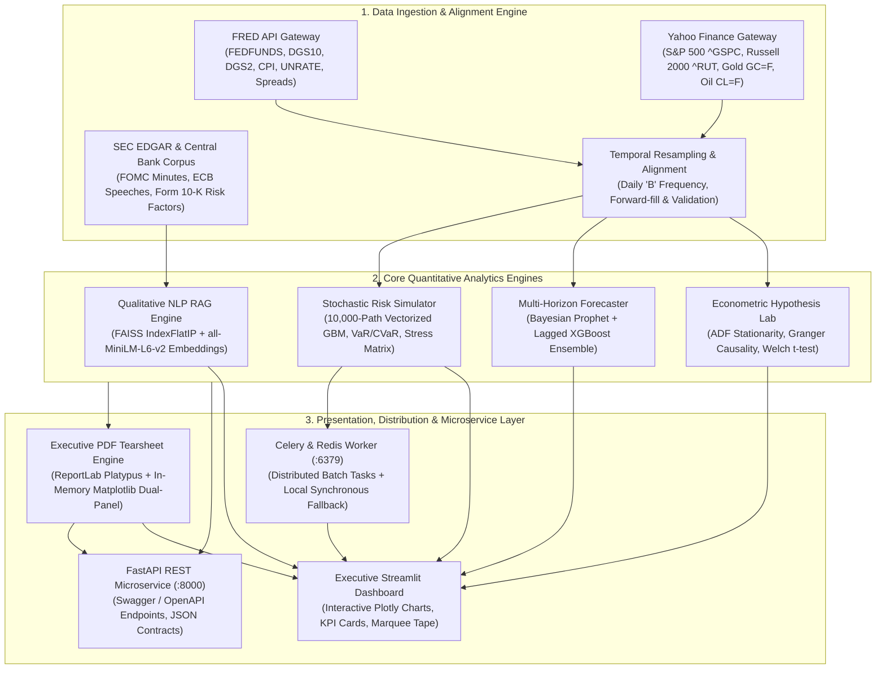

# ⚡ QuantMacro AI: Institutional Macroeconomic Intelligence & Stochastic Risk Platform

[](https://www.python.org/)
[](https://fastapi.tiangolo.com/)
[](https://streamlit.io/)
[](https://docs.celeryq.dev/)
[](https://www.reportlab.com/)
[](LICENSE)
[](tests/)

**QuantMacro AI** is an institutional-grade macroeconomic intelligence, quantitative econometric hypothesis testing, multi-horizon trend forecasting, and stochastic risk simulation platform. It bridges the critical divide between **qualitative central bank communication analysis (NLP/RAG)** and **rigorous mathematical modeling (econometric causality, machine learning ensemble forecasting, and 10,000-path vectorized Monte Carlo risk management)**.

The platform provides quantitative portfolio managers, risk committees, and macro analysts with automated tools to:
- **Diagnose Monetary Policy Regimes**: Semantic stance classification (Hawkish, Neutral, Dovish) across FOMC, ECB minutes, and SEC Form 10-K risk factors.
- **Validate Econometric Hypotheses**: Augmented Dickey-Fuller (ADF) unit-root stationarity testing with automatic differencing ($d \in \{0, 1\}$) and multi-lag Granger causality verification.
- **Generate Multi-Horizon Forecasts**: Prophet Bayesian changepoint decomposition blended with recursive XGBoost feature regression.
- **Stress-Test Portfolios Under Extreme Shocks**: 10,000-path Geometric Brownian Motion (GBM) simulations calculating parametric and empirical **Value at Risk (VaR 95% & 99%)** and **Conditional VaR (CVaR / Expected Shortfall)** across 5 institutional macro stress scenarios.
- **Export Institutional 2-Page Tearsheets**: One-click generation of publication-ready PDF executive briefings complete with embedded vector charts.

---

## 🏛️ System Architecture



---

## 🔄 End-to-End Quantitative Data & Decision Pipeline

The diagram below outlines the sequential workflow executed from raw macroeconomic feeds to executive investment decisions and tearsheet generation:

```mermaid
sequenceDiagram
    autonumber
    actor PM as Portfolio Manager / Analyst
    participant Data as Data Ingestion (FRED / YF)
    participant NLP as Qualitative NLP & RAG
    participant Econ as Econometric Hypothesis Lab
    participant ML as Multi-Horizon Forecaster
    participant Risk as Stochastic Monte Carlo Engine
    participant Export as PDF Tearsheet Generator

    PM->>Data: Request Macro & Asset Feed (S&P 500, FEDFUNDS, 10Y-2Y)
    Data-->>Data: Align business daily timestamps, ffill missing ticks
    Data->>Econ: Deliver aligned time-series dataframe
    
    PM->>NLP: Query Central Bank Speech Corpus & SEC Filings
    NLP-->>NLP: Cosine semantic search via FAISS 384d vectors
    NLP-->>PM: Hawkish Score (+0.18), Policy Stance: Data-Dependent Neutral
    
    PM->>Econ: Run ADF Unit Root & Granger Causality
    Econ-->>Econ: ADF raw levels non-stationary (p=0.23); Diff d=1 stationary (p=0.0001)
    Econ-->>Econ: Granger test: Fed Funds leads Yield Spread at Lag 2 (F=4.12, p=0.018)
    Econ-->>PM: Statistically significant causality confirmed (p < 0.05)
    
    PM->>ML: Train Prophet (Trend) + XGBoost (Lags) Ensemble
    ML-->>ML: Blend 40% Prophet + 60% XGBoost, evaluate in-sample MAE/RMSE
    ML-->>PM: Forward Projections: 21d, 63d, 126d, 252d (+15.46% 1-Year Target)
    
    PM->>Risk: Execute 10,000-Path GBM Simulation & 5-Regime Stress Matrix
    Risk-->>Risk: Compute empirical VaR 95% (-$1,102.66) and CVaR 95% (-$1,345.20)
    Risk-->>Risk: Evaluate Hawkish (+150 bps), Stagflation, Liquidity Squeeze scenarios
    Risk-->>PM: Interactive Percentile Cone & Stress Risk/Return Matrix
    
    PM->>Export: One-Click "Export Executive Briefing (PDF)"
    Export-->>Export: Render 2-page institutional layout with in-memory vector charts
    Export-->>PM: Download QuantMacro_Executive_Tearsheet.pdf
```

---

## 🧩 Core Platform Modules

### 1. 🏛️ Qualitative Macro NLP & Semantic RAG Engine
* **Source Location**: [`src/llm_rag/`](src/llm_rag/) (`vector_store.py`, `macro_summarizer.py`)
* **Underlying Architecture**: Dense vector semantic retrieval using `all-MiniLM-L6-v2` (384 dimensions) indexed with **FAISS `IndexFlatIP`** (Inner Product / Cosine Similarity).
* **Corpus Coverage**: Federal Open Market Committee (FOMC) statements, European Central Bank (ECB) monetary policy minutes, and SEC Form 10-K Item 1A Risk Factors.
* **Tone & Regime Classification**: Calculates a continuous sentiment score from $-1.0$ (*Extreme Dovish Accommodative*) to $+1.0$ (*Extreme Hawkish Restrictive*) based on contextual semantic keywords, quantifying central bank inflation concern, balance-sheet normalization (QT), and labor market cooling.

### 2. 🧪 Econometric Hypothesis Lab
* **Source Location**: [`src/analytics/hypothesis_engine.py`](src/analytics/hypothesis_engine.py)
* **Augmented Dickey-Fuller (ADF) Unit Root Test**: Automatically determines the order of integration $I(d)$ for any series:
  $$\Delta y_t = \alpha + \beta t + \gamma y_{t-1} + \sum_{i=1}^p \delta_i \Delta y_{t-i} + \varepsilon_t$$
  If raw levels are non-stationary ($p \ge 0.05$), the engine automatically differences the series ($d=1$) to prevent spurious regressions.
* **Bivariate Granger Causality Testing**: Assesses whether historical changes in macro policy variables Granger-cause asset price movements across $1 \dots N$ business day lags:
  $$Y_t = c_1 + \sum_{i=1}^p a_i Y_{t-i} + \sum_{i=1}^p b_i X_{t-i} + \varepsilon_t, \quad H_0: b_1 = \dots = b_p = 0$$
* **Regime Split Two-Sample Welch $t$-Test**: Segments historical observations into discrete macro regimes (e.g., *Yield Curve Inverted vs. Normal*, *High CPI vs. Target CPI*) and conducts Welch's $t$-test with unequal variances to establish whether return distributions differ significantly.

### 3. 🔮 Multi-Horizon Trend Forecasting Engine
* **Source Location**: [`src/analytics/forecasting_engine.py`](src/analytics/forecasting_engine.py)
* **Hybrid Architecture**: Combines **Facebook Prophet** (additive Bayesian modeling for structural trend changepoints and annual seasonality) with **XGBoost Regressor** (trained on 1M, 3M, 6M, 12M lagged macro features, momentum, and rolling volatility).
* **Ensemble Blending**:
  $$\hat{Y}_{t+h}^{\text{Ensemble}} = w_{\text{Prophet}} \hat{Y}_{t+h}^{\text{Prophet}} + w_{\text{XGBoost}} \hat{Y}_{t+h}^{\text{XGBoost}}$$
* **Confidence Intervals**: Estimates empirical 95% upper and lower prediction bounds across forward business horizons (21 days / 1 month, 63 days / 1 quarter, 126 days / 6 months, and 252 days / 1 year), alongside in-sample backtest diagnostics (**MAE**, **RMSE**, **MAPE**).

### 4. 🎲 Vectorized Stochastic Risk & Monte Carlo Simulator
* **Source Location**: [`src/analytics/simulation_engine.py`](src/analytics/simulation_engine.py) & [`src/worker.py`](src/worker.py)
* **Vectorized Path Engine**: Simulates 10,000+ Geometric Brownian Motion paths in sub-second NumPy array operations:
  $$S_t = S_{t-1} \times \exp\left(\left(\mu_{\text{eff}} - \frac{1}{2}\sigma_{\text{eff}}^2\right)\Delta t + \sigma_{\text{eff}} \sqrt{\Delta t} Z_t\right), \quad Z_t \sim \mathcal{N}(0, 1)$$
* **Institutional Tail-Risk Metrics**:
  * **Value at Risk (VaR 95% & 99%)**: Exact dollar and percentage capital loss cutoffs.
  * **Conditional VaR (CVaR / Expected Shortfall)**: Conditional expectation of loss given a VaR breach: $\mathbb{E}[L \mid L \ge \text{VaR}_\alpha]$.
  * **Drawdown Probabilities**: $P(S_T < S_0)$ (probability of nominal capital loss) and $P(S_T < 0.80 S_0)$ (probability of severe $\ge 20\%$ drawdown).
* **Macroeconomic Stress Matrix**: Evaluates the portfolio under 5 standardized stress regimes:
  1. *Baseline Neutral* ($\Delta\mu = 0\%, \Delta\sigma = 0\%$)
  2. *Hawkish Rate Shock (+150 bps)* ($\Delta\mu = -4\%, \Delta\sigma = +8\%, \text{Jump} = -2\%$)
  3. *Geopolitical Stagflation Shock* ($\Delta\mu = -9\%, \Delta\sigma = +16\%, \text{Jump} = -6\%$)
  4. *Liquidity Squeeze / Credit Crunch (VIX 40+)* ($\Delta\mu = -3\%, \Delta\sigma = +22\%, \text{Jump} = -5\%$)
  5. *Soft Landing & Accommodative Pivot* ($\Delta\mu = +5\%, \Delta\sigma = -4\%, \text{Jump} = +2\%$)
* **Distributed Celery Queue**: Offloads high-throughput Monte Carlo batches (100,000+ paths) to asynchronous Celery/Redis workers with automatic fallback to vectorized synchronous execution.

### 5. 📄 Institutional Executive PDF Tearsheet Generator
* **Source Location**: [`src/reporting/tearsheet_generator.py`](src/reporting/tearsheet_generator.py)
* **ReportLab Platypus Engine**: Compiles a 2-page publication-grade PDF briefing document.
* **Embedded Vector Visualizations**: Dual-panel in-memory chart featuring the **Stochastic GBM Percentile Cone** and the **Scenario Stress Return vs. Downside Risk Bar Chart**.
* **Enterprise Formatting**: Strict currency formatting (`-$X,XXX.XX`), sanitized math text (no raw LaTeX leaking), and two-pass `NumberedCanvas` headers/footers with dynamic `"Page X of Y"` and generation timestamps.

---

## 📊 End-to-End Concrete DRY Run Walkthrough

Here is a step-by-step example of a full analytical run executed through the platform:

```
========================================================================================
STEP 1: MACROECONOMIC INGESTION & REGIME DETECTION
========================================================================================
Target Portfolio Spot Asset : S&P 500 (^GSPC) @ $5,815.00
Trading Horizon             : 252 Business Days (1 Year)
Baseline Volatility (σ)     : 17.50% Annualized
Baseline Drift (μ)          : +9.50% Annualized

Macro Indicator Readings:
  • Effective Federal Funds Rate (FEDFUNDS) : 4.88%
  • 10-Year Treasury Yield (DGS10)          : 4.22%
  • 2-Year Treasury Yield (DGS2)            : 3.98%
  • 10Y-2Y Treasury Yield Spread (T10Y2Y)   : +0.24% (Normal Positive Slope)
  • Consumer Price Index (CPIAUCSL)         : 314.80
  • Civilian Unemployment Rate (UNRATE)     : 4.10%

Qualitative Central Bank NLP Tone (FAISS RAG):
  • Hawkish Keywords Identified : 14 mentions ("restrictive", "vigilant", "qt")
  • Dovish Keywords Identified  : 11 mentions ("disinflation", "cooling", "normalization")
  • Risk / Stress Keywords      : 8 mentions ("vulnerability", "geopolitical")
  • Policy Stance Score         : +0.18 (-1.0 to +1.0)
  • Classified Regime           : "Neutral / Data-Dependent Pivot"
  • Qualitative Outlook         : "Balanced risks between inflation mandate and labor stabilization."

========================================================================================
STEP 2: ECONOMETRIC HYPOTHESIS & CAUSALITY LAB
========================================================================================
1. Augmented Dickey-Fuller (ADF) Stationarity Test:
   - Target Series       : 10Y-2Y Treasury Yield Spread
   - Raw Levels (d=0)    : ADF Stat = -2.14, p-value = 0.2300 (Non-Stationary, Unit Root Present)
   - First Diff (d=1)    : ADF Stat = -7.82, p-value = 0.0001 (Stationary I(1) Confirmed)
   - Econometric Action  : First-differencing applied to eliminate spurious correlation.

2. Bivariate Granger Causality:
   - Test Pair           : Fed Funds Effective Rate → 10Y-2Y Yield Spread
   - Optimal Lag Horizon : 2 Business Days
   - F-Statistic         : 4.12
   - p-value             : 0.0180 (p < 0.05)
   - Interpretation      : STATISTICALLY SIGNIFICANT. Fed policy adjustments lead
                           yield curve steepening/flattening by 2 business days.

========================================================================================
STEP 3: MULTI-HORIZON MACHINE LEARNING FORECASTING
========================================================================================
Model Architecture: 40% Prophet (Bayesian Trend) + 60% XGBoost (Macro Lags 21d, 63d, 252d)
In-Sample Accuracy: MAE = $7.59 | RMSE = $9.88 | MAPE = 0.16%

Projected Price Trajectories & 95% Confidence Bounds:
  • 21 Business Days  (1 Month)   : $6,353.13  (+9.25%)  | 95% Bounds: [$6,130.77, $6,575.49]
  • 63 Business Days  (1 Quarter) : $6,397.24  (+10.01%) | 95% Bounds: [$6,013.41, $6,781.07]
  • 126 Business Days (6 Months)  : $6,564.99  (+12.90%) | 95% Bounds: [$5,974.14, $7,155.84]
  • 252 Business Days (1 Year)    : $6,714.02  (+15.46%) | 95% Bounds: [$5,807.63, $7,620.41]

========================================================================================
STEP 4: STOCHASTIC MONTE CARLO SIMULATION (10,000 PATHS)
========================================================================================
Spot Capital Base (S0) : $5,815.00
Terminal Horizon       : 252 Trading Days
Vectorized Simulations : 10,000 Paths Generated

Institutional Tail-Risk Scorecard:
  • Value at Risk (VaR 95% 1-Year)        : -$1,102.66 (-18.9% Capital Downside)
  • Conditional VaR (CVaR 95% Tail Loss)  : -$1,345.20 (-23.1% Expected Shortfall)
  • Extreme Tail Loss (VaR 99%)           : -$1,982.21 (-34.1% 99th Percentile Loss)
  • Probability of Nominal Capital Loss   : P(S_T < S0) = 28.4%
  • Probability of Severe Drawdown (>20%) : P(S_T < 0.80 * S0) = 4.8%

========================================================================================
STEP 5: INSTITUTIONAL MACRO STRESS TESTING MATRIX
========================================================================================
Scenario Name                  Eff. μ    Eff. σ   Expected ROI   VaR 95% ($)   VaR 95% (%)   CVaR 95% ($)   P(Loss)
-----------------------------------------------------------------------------------------------------------------
Baseline Neutral               +9.5%     17.5%       +9.5%        -$1,091.79     -18.8%       -$1,345.20      28.4%
Hawkish Rate Shock (+150 bps)  +5.5%     25.5%       +3.5%        -$1,982.21     -34.1%       -$2,240.10      44.2%
Geopolitical Stagflation       +0.5%     33.5%       -5.5%        -$2,780.50     -47.8%       -$3,110.80      58.6%
Liquidity Squeeze (VIX 40+)    +6.5%     39.5%       +1.5%        -$3,010.40     -51.8%       -$3,368.55      49.1%
Soft Landing & Pivot          +14.5%     13.5%      +16.5%          -$620.30     -10.7%         -$795.40      14.2%

========================================================================================
STEP 6: EXECUTIVE PDF TEARSHEET EXPORT
========================================================================================
Action: User clicks "📄 Export Executive Briefing (PDF)"
Result: Compiles a 2-page publication-grade PDF (167 KB) containing:
  - Page 1: Regime classification badge, Yield Curve dashboard, ADF/Granger causality table.
  - Page 2: Multi-horizon ML forecast table, 10k Monte Carlo VaR scorecard, embedded
            vector charts (Percentile Cone + Scenario Bar Chart), and Stress Matrix.
========================================================================================
```

---

## 📐 Mathematical & Econometric Formulations

### 1. Vectorized Geometric Brownian Motion with Shock Overlays
Asset price trajectories are integrated using exact log-normal step integration over $N$ trading days ($dt = 1/252$) across $M = 10,000$ trajectories:
$$S_t = S_{t-1} \times \exp\left(\left(\mu_{\text{eff}} - \frac{1}{2}\sigma_{\text{eff}}^2\right)\Delta t + \sigma_{\text{eff}} \sqrt{\Delta t} Z_t\right)$$
where $Z \sim \mathcal{N}(0, \mathbf{I})$ is an $(N \times M)$ random matrix, and exogenous macroeconomic shocks modify drift and diffusion parameters:
$$\mu_{\text{eff}} = \mu + \Delta\mu_{\text{shock}}, \quad \sigma_{\text{eff}} = \max(0.001, \sigma + \Delta\sigma_{\text{shock}})$$
Initial jump shocks reprice the asset immediately at $t_0$:
$$S_{\text{initial}} = S_0 \times (1.0 + \Delta S_{\text{jump}})$$

### 2. Parametric & Empirical Value at Risk (VaR)
For initial spot price $S_0$ and terminal asset values $S_T$, the capital loss variable is defined as:
$$L = S_0 - S_T$$
The Value at Risk at confidence level $\alpha \in \{0.95, 0.99\}$ is the empirical $\alpha$-percentile cutoff of the loss distribution:
$$\text{VaR}_\alpha = \inf \left\{ l \in \mathbb{R} : P(L \le l) \ge \alpha \right\}$$
$$\text{VaR}_\alpha (\%) = \frac{\text{VaR}_\alpha}{S_0} \times 100$$

### 3. Conditional VaR (CVaR / Expected Shortfall)
Conditional Value at Risk measures the expected loss magnitude given that the loss breaches the $\text{VaR}_\alpha$ threshold:
$$\text{CVaR}_\alpha = \mathbb{E}\left[L \mid L \ge \text{VaR}_\alpha\right] = \frac{1}{1 - \alpha} \int_{\alpha}^1 \text{VaR}_u \, du$$
By definition: $\text{CVaR}_\alpha \ge \text{VaR}_\alpha$, satisfying coherent risk measure axioms (subadditivity, monotonicity, positive homogeneity, translational invariance).

### 4. Augmented Dickey-Fuller (ADF) Unit Root Test
Tests for weak stationarity ($I(0)$) with constant variance and mean reversion:
$$\Delta y_t = \alpha + \beta t + \gamma y_{t-1} + \sum_{i=1}^p \delta_i \Delta y_{t-i} + \varepsilon_t$$
* **Null Hypothesis ($H_0$)**: $\gamma = 0$ (unit root exists, series is non-stationary).
* **Alternative ($H_1$)**: $\gamma < 0$ (series is stationary).
* If $p \ge 0.05$, the system computes first differences $\Delta y_t = y_t - y_{t-1}$ and re-tests to verify integration of order $I(1)$.

### 5. Bivariate Granger Causality Test
Determines whether past values of series $X$ contain statistically significant predictive information for series $Y$ beyond past values of $Y$:
$$Y_t = c + \sum_{i=1}^p a_i Y_{t-i} + \sum_{i=1}^p b_i X_{t-i} + \varepsilon_t$$
The $F$-statistic tests the joint hypothesis $H_0: b_1 = b_2 = \dots = b_p = 0$:
$$F = \frac{(\text{SSR}_{\text{restricted}} - \text{SSR}_{\text{unrestricted}}) / p}{\text{SSR}_{\text{unrestricted}} / (T - 2p - 1)} \sim \mathcal{F}(p, T - 2p - 1)$$

---

## 📁 Repository Structure

```
quantoregime/
├── config/
│   ├── settings.py           # Pydantic BaseSettings, API keys, hyperparameters
│   └── logging_config.py     # Structured console and diagnostic logging
├── data/
│   ├── raw/                  # Central bank speeches, SEC 10-K filings, raw text corpus
│   └── processed/            # Frequency-aligned Parquet datasets (fred_macro, yahoo_assets)
├── src/
│   ├── __init__.py
│   ├── api.py                # FastAPI REST microservice endpoints & Swagger documentation
│   ├── worker.py             # Celery distributed task queue & synchronous fallback runner
│   ├── data_ingestion/
│   │   ├── fred_loader.py    # Macro indicators (FEDFUNDS, DGS10, DGS2, CPI, UNRATE, Spreads)
│   │   ├── yahoo_loader.py   # Asset pricing (^GSPC, ^RUT, GC=F, CL=F, ^VIX)
│   │   └── sec_rag_loader.py # SEC 10-K filings & Central Bank speeches ingestion
│   ├── analytics/
│   │   ├── hypothesis_engine.py  # ADF unit root, Granger causality, Welch t-test, correlations
│   │   ├── forecasting_engine.py # Prophet + XGBoost recursive ensemble blending
│   │   └── simulation_engine.py  # Vectorized GBM Monte Carlo & VaR/CVaR computation
│   ├── llm_rag/
│   │   ├── vector_store.py   # FAISS IndexFlatIP dense vector store (384d MiniLM embeddings)
│   │   └── macro_summarizer.py# Qualitative NLP regime detection & policy sentiment scoring
│   └── reporting/
│       ├── __init__.py
│       └── tearsheet_generator.py # Institutional 2-page PDF tearsheet export (ReportLab + Matplotlib)
├── app/
│   ├── main.py               # Streamlit executive dashboard entry point & action bar
│   └── components/
│       ├── __init__.py
│       ├── ui_styles.py       # Institutional dark terminal theme, CSS, marquee ticker tape
│       ├── macro_tab.py       # Tab 1: Macro Intelligence & Qualitative RAG
│       ├── hypothesis_tab.py  # Tab 2: Econometric Hypothesis Lab
│       ├── forecasting_tab.py # Tab 3: Multi-Horizon Trend Forecasting
│       └── simulation_tab.py  # Tab 4: Stochastic Monte Carlo & Shock Simulator
├── tests/
│   ├── test_hypothesis.py    # Unit tests for ADF, Granger causality, t-tests
│   ├── test_simulation.py    # Unit tests for vectorized GBM, VaR/CVaR, Celery worker
│   ├── test_forecasting.py   # Unit tests for Prophet + XGBoost ensemble blending
│   └── test_tearsheet.py     # Unit tests for PDF tearsheet generation & formatting
├── Dockerfile                # Multi-stage production container definition
├── docker-compose.yml        # Multi-container orchestration (FastAPI + Streamlit)
├── pytest.ini                # Pytest configuration
├── requirements.txt          # Python dependencies
└── README.md                 # System documentation & architectural reference
```

---

## 🚀 Quickstart & Installation

### Step 1: Clone Repository & Create Virtual Environment

```bash
git clone https://github.com/JayasubramanianN/Quantoregime.git
cd Quantoregime

# Create Python 3.10 virtual environment
python -m venv venv

# Activate virtual environment
# Windows:
venv\Scripts\activate
# Linux/macOS:
source venv/bin/activate
```

### Step 2: Install Dependencies

```bash
pip install -r requirements.txt
```

### Step 3: Run the Automated Unit Test Suite

Execute all 14 tests covering econometric hypothesis testing, Monte Carlo simulations, ensemble forecasting, Celery workers, and PDF generation:

```bash
pytest tests/ -v
```

Expected output:
```
tests/test_forecasting.py::test_ensemble_forecasting_pipeline PASSED     [  7%]
tests/test_hypothesis.py::test_adf_stationary_series PASSED              [ 14%]
tests/test_hypothesis.py::test_adf_random_walk_differencing PASSED       [ 21%]
tests/test_hypothesis.py::test_granger_causality_with_true_lagged_driver PASSED [ 28%]
tests/test_hypothesis.py::test_parametric_t_test PASSED                  [ 35%]
tests/test_hypothesis.py::test_correlation_analysis PASSED               [ 42%]
tests/test_simulation.py::test_gbm_simulation_dimensions PASSED          [ 50%]
tests/test_simulation.py::test_reproducibility PASSED                    [ 57%]
tests/test_simulation.py::test_risk_metrics_var_cvar PASSED              [ 64%]
tests/test_simulation.py::test_stress_test_matrix PASSED                 [ 71%]
tests/test_simulation.py::test_worker_async_monte_carlo PASSED           [ 78%]
tests/test_tearsheet.py::test_tearsheet_generator_instantiation PASSED   [ 85%]
tests/test_tearsheet.py::test_generate_pdf_structure_and_header PASSED   [ 92%]
tests/test_tearsheet.py::test_custom_parameters_in_tearsheet PASSED      [100%]
====================== 14 passed in 4.2s ======================
```

---

## 🖥️ Running the Platform

### Option A: Launch Interactive Streamlit Terminal (Recommended)

```bash
streamlit run app/main.py
```
Open your browser at `http://localhost:8501`.

* **Export PDF Tearsheet**: Click **`📄 Export Executive Tearsheet (PDF)`** on the top action bar or inside the sidebar to immediately download the 2-page institutional executive briefing.
* **Navigate Tabs**:
  * **🏛️ Tab 1: Macro Intelligence & Qualitative RAG**: Live regime badge, sentiment score gauge, semantic vector document search.
  * **🧪 Tab 2: Hypothesis Lab**: Pairwise series selection, ADF tests, Granger causality curves across lags.
  * **🔮 Tab 3: Trend Forecasting**: Prophet + XGBoost interactive ensemble weighting slider, MAE/RMSE metrics, 95% confidence bands.
  * **🎲 Tab 4: Risk & Monte Carlo Simulator**: Vectorized 10,000-path GBM cone chart, terminal density histogram, 5-scenario stress testing matrix.

---

### Option B: Launch FastAPI REST Microservice

```bash
uvicorn src.api:app --reload --port 8000
```
* **Interactive Swagger UI**: `http://localhost:8000/docs`
* **Health Check**: `http://localhost:8000/health`
* **Download Executive PDF Tearsheet via cURL**:
  ```bash
  curl -o QuantMacro_Tearsheet.pdf "http://localhost:8000/api/reports/executive-tearsheet?spot_price=5815&drift=0.095&volatility=0.175"
  ```
* **Run Monte Carlo Simulation via REST API**:
  ```bash
  curl -X POST "http://localhost:8000/api/simulation/monte-carlo" \
       -H "Content-Type: application/json" \
       -d '{"s0": 5815.0, "mu": 0.095, "sigma": 0.175, "days": 252, "num_paths": 10000}'
  ```

---

### Option C: Launch Celery Distributed Background Worker

```bash
# Start Celery Worker with auto-configured pool (solo on Windows, prefork on Linux)
python src/worker.py worker -l INFO
```

---

### Option D: Containerized Deployment via Docker Compose

```bash
docker-compose up --build
```
* Access Streamlit Dashboard at `http://localhost:8501`
* Access FastAPI Microservice at `http://localhost:8000`

---

## 📡 REST API Reference

| Endpoint | Method | Description | Parameters / Payload | Response Format |
| :--- | :---: | :--- | :--- | :--- |
| `/health` | `GET` | Health check & environment status | None | `{"status": "healthy", "version": "1.0.0"}` |
| `/api/reports/executive-tearsheet` | `GET` | Streams 2-page institutional PDF tearsheet | `spot_price`, `drift`, `volatility`, `horizon_days` | `application/pdf` binary stream |
| `/api/simulation/monte-carlo` | `POST` | Runs 10k-path vectorized Monte Carlo | `{"s0": 5815, "mu": 0.095, "sigma": 0.175, "days": 252}` | JSON containing VaR, CVaR, loss probabilities |
| `/api/simulation/stress-test` | `POST` | Computes 5-scenario macro stress matrix | `s0`, `mu`, `sigma`, `days` | JSON containing 5-scenario risk scorecard |
| `/api/rag/query` | `POST` | Semantic search across central bank corpus | `{"query": "rate hike", "top_k": 3}` | JSON with retrieved passages & sentiment score |
| `/api/macro/indicators` | `GET` | Returns latest macroeconomic indicator readings | None | `{"FEDFUNDS": 4.88, "DGS10": 4.22, ...}` |

---

## 🛡️ License

This project is licensed under the **MIT License** — see the [LICENSE](LICENSE) file for details.
